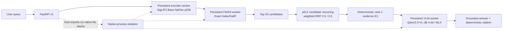

# UI-RAG: Production Multimodal Retrieval & Grounded Generation for Mobile UI Screens

A portfolio-grade multimodal RAG system for **retrieving mobile UI screenshots from RICO and generating grounded answers about the selected screen**. The project evolves a small legacy CLIP + FAISS prototype into a measured, evaluated, locally served system with exact retrieval, coarse-to-fine reranking, local VLM generation, human-audited evaluation, resilient FastAPI serving, metrics, CI, and controlled backpressure.

> **Status:** M1–M9 validated; **M10 portfolio release candidate**. The ML and serving semantics are frozen. M10 packages the validated system for public review and demonstration.

## Why this project is interesting

This repository is intentionally built as an **evidence-driven engineering case study**, not as a single-model demo. Each major design choice was tested against a measurable gate:

- the legacy CLIP baseline was benchmarked before changing models;
- SigLIP2 NaFlex was selected by the same frozen Screen2Words protocol;
- HNSW was rejected when it failed the required exact-neighbor recall gate;
- p512 reranking was retained only after a frozen-test gain;
- VLM evidence selection and VLM abstention were both removed after negative ablations;
- a same-family automated VLM judge was rejected after corruption calibration failed;
- per-request subprocess loading was replaced by persistent isolated workers after latency measurement;
- overload is handled by explicit HTTP 429 backpressure instead of competing for Apple unified memory.

The result is a system where the **retriever chooses evidence, application code owns provenance, and the VLM only interprets the selected screenshot**.

## Key results

| Area | Result |
|---|---:|
| Corpus | **66,261** canonical RICO screenshots |
| Legacy CLIP Screen2Words Recall@10 | **4.83%** |
| SigLIP2 Base NaFlex p256 Recall@10 | **16.22%** |
| Final text retriever + p512 RRF Recall@10 | **16.73%** |
| Relative R@10 gain vs legacy CLIP | **3.47×** |
| Warm `/v1/search` latency | **171 ms** |
| Search speedup vs per-request subprocess serving | **~89×** |
| Human-audited generation faithfulness | **91.67%** |
| Human-audited relevance | **75.00%** |
| Human-audited completeness | **75.00%** |
| Major unsupported-claim rate | **8.33% (1/12)** |
| Final local quality gate | **109 tests passed + Ruff + release contracts + compileall** |
| Backpressure smoke | **1×200 + 5×429, 0×5xx** at concurrency 6 |

Semantic human-audit percentages are normalized means from a 12-case blinded audit, not population-level estimates. See [M7 Final Results](docs/M7_FINAL_RESULTS.md).

## Final architecture



The FastAPI host does **not** import PyTorch, FAISS, MLX, or `mlx_vlm`. Those native stacks live in separate long-lived workers, preserving the crash-avoidance isolation discovered during M1 while avoiding repeated model loading.

## System evolution

| Milestone | Question | Decision / result |
|---|---|---|
| M1 | Can the legacy project be made reproducible? | Canonical RICO mapping, manifests, hashes, exact FAISS, resumable builds, macOS native isolation |
| M2 | How good is the baseline? | Screen2Words R@10 **4.83%**; encoder is the quality/latency bottleneck |
| M3 | Which modern encoder helps? | SigLIP2 NaFlex p256 selected; R@10 **16.22%** |
| M4 | Is ANN worthwhile? | HNSW rejected: best tested neighbor R@10 **92.88% < 95% gate**; exact FlatIP retained |
| M5 | Can coarse-to-fine reranking help? | p512 Top-20 RRF selected; R@10 **16.73%** |
| M6 | How should the VLM participate? | selector and verifier rejected; final role = **generation only** on deterministic E1 |
| M7 | How trustworthy is generation? | deterministic checks + blinded human audit; same-family judge rejected after calibration collapse |
| M8 | Can it be served as an API? | FastAPI v1 + persistent isolated workers; warm search **171 ms** |
| M9 | Is it operationally robust? | JSON logs, metrics, timeouts, recovery, CI, controlled 429 backpressure |
| M10 | Can a reviewer understand and reproduce it quickly? | portfolio packaging, release docs, demo script, architecture/results narrative |

## Quick start — validated Apple Silicon profile

The validated data plane is **native macOS on Apple Silicon** with Python 3.12. Large RICO/model/index artifacts are intentionally not bundled in the repository.

```bash
python3.12 -m venv .venv
source .venv/bin/activate
make m9-setup
make m9-quality
```

For a fresh build, download RICO and follow the reproducibility guide:

- [Reproducibility](docs/REPRODUCIBILITY.md)
- [M9 Deployment Policy](docs/M9_DEPLOYMENT.md)

## Run the production-style API

With the validated artifacts present:

```bash
make m9-serve
```

Control plane:

```bash
curl -sS http://127.0.0.1:8000/health
curl -sS http://127.0.0.1:8000/ready
curl -sS http://127.0.0.1:8000/v1/model-info
```

Search:

```bash
curl -sS \
  -X POST http://127.0.0.1:8000/v1/search \
  -H 'Content-Type: application/json' \
  -H 'X-Request-ID: portfolio-search' \
  -d '{"query":"dark banking login screen","top_k":4}'
```

Grounded RAG:

```bash
curl -sS \
  -X POST http://127.0.0.1:8000/v1/rag \
  -H 'Content-Type: application/json' \
  -H 'X-Request-ID: portfolio-rag' \
  -d '{"query":"dark banking login screen","max_tokens":128}'
```

For the validated demo query, the frozen retriever returns `61042.jpg` at rank 1 and the VLM describes the Wright-Patt Credit Union mobile-banking login screen while citing deterministic evidence `E1`.

Interactive OpenAPI docs are available at `http://127.0.0.1:8000/docs`. Prometheus-compatible metrics are exposed at `/metrics` but intentionally hidden from the public OpenAPI schema.

## Evaluation integrity

A central design goal is to avoid reporting flattering metrics without checking whether the evaluator itself works.

### Retrieval

Screen2Words uses **exact target screen identity** as relevance. This is stricter than subjective semantic similarity and makes comparisons deterministic across encoder/index variants.

### Multimodal fusion diagnostic

The M5 text+visual-exemplar experiment reached **77.05% R@10**, but the exemplar was target-conditioned. It is therefore reported only as a diagnostic upper-bound and is **not** presented as production retrieval performance.

### Generation evaluation

The first automated Qwen2.5-VL judge returned perfect `F2 R2 U0 C2` scores for every original answer. M7.1 then injected irrelevant, unsupported-sentinel, and truncated corruptions. The judge detected **0%** of them and still gave perfect scores to **100%** of corrupted answers. Those automated semantic scores were discarded. Final semantic reporting uses a blinded human audit.

See [Evaluation & Benchmarks](docs/BENCHMARKS.md).

## Operational behavior

The production profile defaults to one concurrent heavy inference request on the validated MacBook configuration. Additional concurrent requests receive HTTP `429` rather than competing for unified memory.

M9 acceptance deliberately killed the FAISS worker and verified automatic recovery on the next request. `/ready` exposes worker liveness/restart/timeout counters, while `/metrics` exposes request, stage, backpressure, and worker metrics.

See [M9 Runbook](docs/M9_RUNBOOK.md).

## Repository map

```text
src/ui_rag/
  api/                  FastAPI app, service, persistent worker orchestration, metrics
  embeddings/           CLIP and SigLIP2 encoders
  evaluation/           Screen2Words retrieval evaluation
  generation_eval/      generation checks, judge calibration, human audit
  indexing/             artifact manifests and FAISS construction
  rag/                  evidence schema, image prep, MLX VLM integration

scripts/                 reproducible build / benchmark / smoke / release utilities
docs/                    protocols, final results, reference JSON/CSV, portfolio docs
tests/                   unit, contract, native-isolation, operational tests
legacy/                  original supplied prototype files, preserved for auditability
data_storage/            mapping + ignored external datasets
artifacts/               ignored generated indexes / embeddings / evaluation artifacts
```

## Portfolio documentation

- [Portfolio Case Study](docs/PORTFOLIO_CASE_STUDY.md) — concise end-to-end engineering story
- [Architecture](docs/ARCHITECTURE.md) — retrieval, RAG, process-isolation, and serving diagrams
- [Benchmarks](docs/BENCHMARKS.md) — consolidated quantitative results and caveats
- [Demo Guide](docs/DEMO.md) — 5-minute live demo and fallback path
- [Interview Guide](docs/INTERVIEW_GUIDE.md) — 30-second, 90-second, and deep-dive narratives
- [Reproducibility](docs/REPRODUCIBILITY.md) — rebuild and validation workflow
- [Release Checklist](docs/RELEASE_CHECKLIST.md) — public-repository hygiene and final gates
- [M9 Final Results](docs/M9_FINAL_RESULTS.md) — final operational acceptance

## Reproducibility and artifact policy

The repository intentionally excludes:

- the full RICO screenshot corpus;
- generated embedding matrices;
- FAISS indexes;
- model weights/caches;
- benchmark-generated query caches and evaluation outputs.

Instead, the project records source hashes, generated artifact hashes, manifests, reference metrics, and commands needed to rebuild the validated state. The original historical `image_index_map.json` is preserved byte-for-byte, including ten legacy Finder-style aliases; the modern pipeline indexes 66,261 canonical screenshots.

## Known limitations

1. **Retrieval is still hard.** Final exact-instance Screen2Words R@10 is 16.73%; semantically similar but different screens count as failures.
2. **Local VLM generation dominates RAG latency.** Warm search can be ~171 ms, while local RAG generation is roughly 15–17 s in the recorded M8.1 runs.
3. **Human generation audit is small.** The blinded semantic audit has 12 cases and one evaluator.
4. **Minor speculative details remain common.** 7/12 audited cases contain some unsupported detail, although only 1/12 contains a major unsupported claim.
5. **Validated data plane is Apple Silicon.** Docker is used for CI/contracts; Linux inference parity for the frozen MLX/VLM stack has not been claimed.
6. **Concurrency is intentionally conservative.** The proven MacBook profile uses one heavy inference request at a time.

## Release quality

The final M9 target-Mac acceptance before M10 packaging was:

```text
Ruff: All checks passed
Pytest: 109 passed
Release-contract smoke: PASSED
compileall: PASSED
Native import isolation: true
FAISS worker recovery: PASSED
Backpressure smoke: 1×200 + 5×429, 0×5xx
```

Run the M10 packaging check with:

```bash
make m10-release-check
```

## Project history

Detailed milestone protocols, ablations, hashes, and final results are retained under `docs/` and the milestone changelogs. This history is intentional: the portfolio value is not only the final architecture, but the measured reasoning that removed components which did not earn their complexity.
