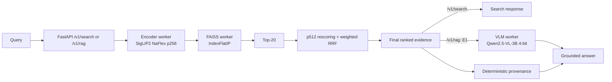
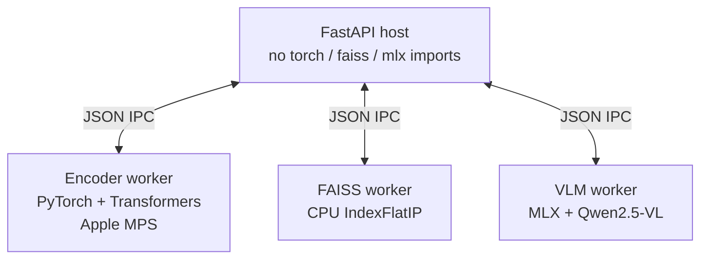
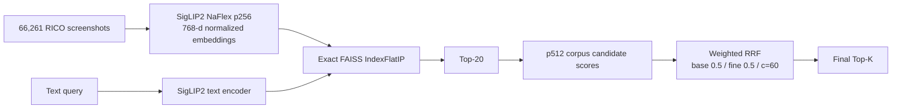
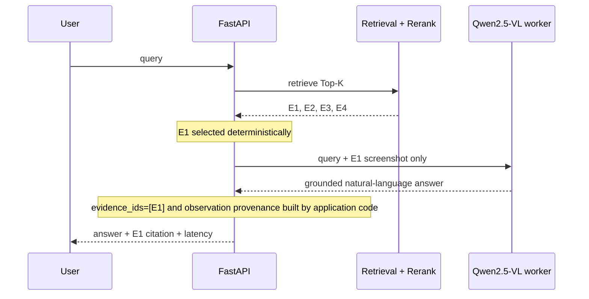
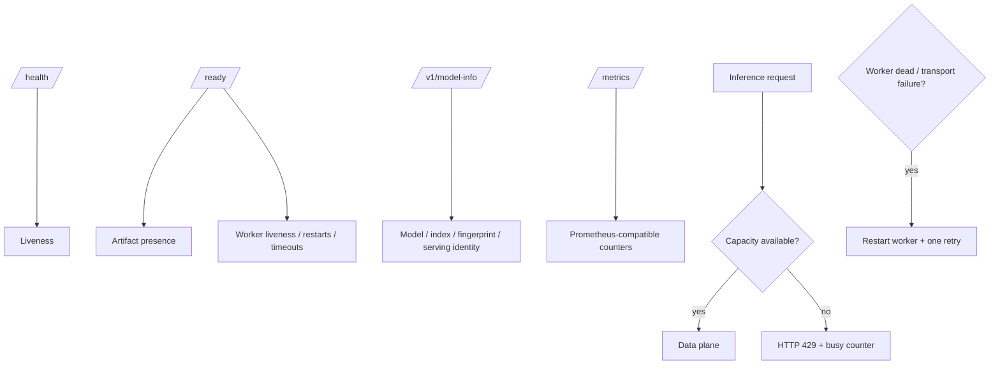

# Architecture

## 1. Online data plane

## 2. Native-process isolation

The host intentionally does not co-load PyTorch, FAISS, and MLX.

This architecture was introduced because loading PyTorch/OpenCLIP and FAISS in the same macOS process caused a native OpenMP crash. M8.1 changed the workers from per-request processes to persistent processes so that isolation remained intact without repeated model startup.

## 3. Retrieval design

The p512 stage does not build another global FAISS index. It only rescales the candidate set produced by the frozen p256 retriever.

## 4. Grounded generation contract

Rejected alternatives are documented in M6:

- VLM multi-image JSON grounding;
- VLM evidence selector;
- VLM verifier/abstention gate.

They were removed because measured quality was worse than simpler deterministic behavior.

## 5. Operational control plane

## 6. Artifact model

Large generated artifacts are not committed. Manifests tie the runtime to:

- source mapping hash;
- canonical mapping hash;
- encoder identity/configuration;
- embedding dimensions and dtype;
- corpus vector count;
- FAISS index hash/type;
- p512 reranker artifact hash;
- library/runtime metadata.

This makes the project reproducible without storing the full corpus, model cache, or hundreds of megabytes of generated arrays/indexes in Git.
